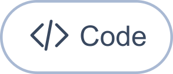
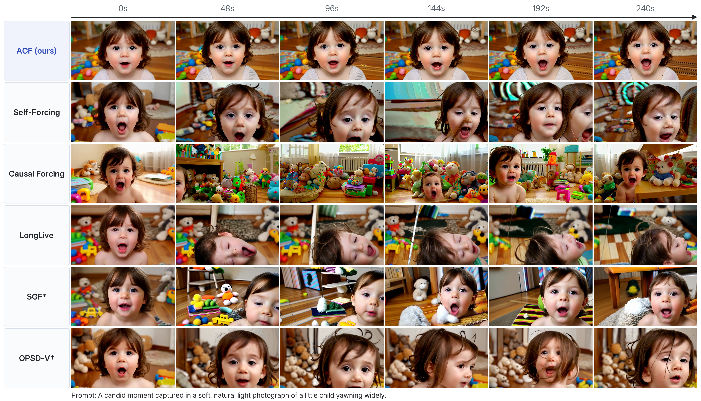
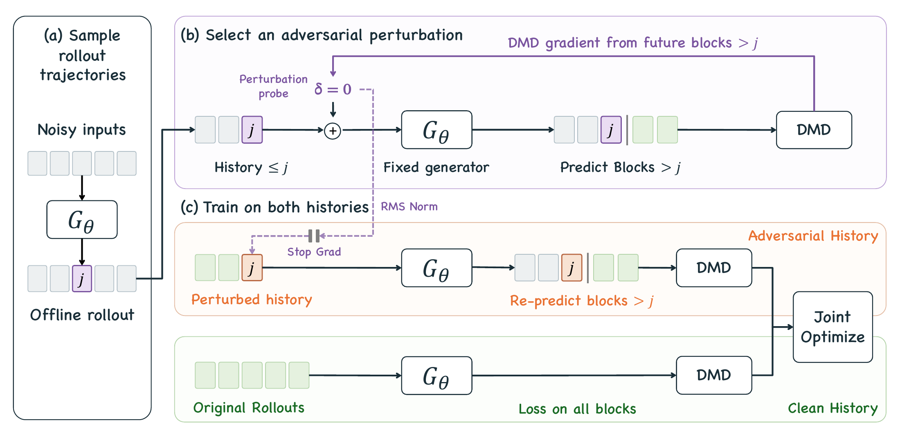

<div align="center">
<p> &nbsp;  &nbsp;  &nbsp;  &nbsp; </p>
<p></p>
<p>Chenxi Xia¹˒² · Yixuan Xu² · Shan Liu² · Jiapeng Wang² · Maohua Li²˒³<br>Hanlin Tang² · Kan Liu² · Tao Lan² · Weiyi Lu² · Xinggao Liu¹</p>
<p>¹ Zhejiang University &nbsp; ² Alibaba Group &nbsp; ³ Nanjing University</p>
<p>
  <a></a>
  <a></a>
  <a href="https://github.com/wuli-art/Adversarial-Gradient-Forcing"></a>
  <a></a>
</p>
</div>

<p><b>TL;DR</b> — AGF mitigates error accumulation in few-step autoregressive video generation by training models to withstand <b>adversarial history perturbations</b>. Trained on only <b>five-second rollouts</b>, AGF sustains high-quality video generation for <b>four minutes</b>.</p>
<a href="project-page/assets/yawning-child-comparison.png"></a>
<p><a href="project-page/assets/yawning-child-comparison.png">View full-resolution comparison</a> &nbsp; · &nbsp; <a href="project-page/assets/videos/049/agf.mp4">Watch the full four-minute AGF generation</a></p>
<p><sub>* SGF: reproduced from the same ODE initialization as AGF. † OPSD-V: official checkpoint post-trained from Self-Forcing.</sub></p>

## Method

Small errors in generated history can accumulate over time. AGF uses **future
prediction gradients** to find challenging history perturbations, then learns
jointly from clean and perturbed histories. Inference keeps the same four-step sampler.

[](project-page/assets/method.png)

[Method and gradient flow →](docs/method.md)

## Results

| Method | 5 s · VBench Total ↑ | 60 s · VBench Total ↑ | 240 s · Quality 5 ↑ |
| --- | ---: | ---: | ---: |
| Self-Forcing | 82.21 | 79.56 | 82.47 |
| Causal Forcing | **82.94** | 79.83 | 81.79 |
| LongLive | 80.34 | 79.81 | 83.62 |
| SGF | 82.08 | 79.67 | 84.07 |
| OPSD-V | 81.95 | 80.06 | 82.84 |
| **AGF (ours)** | 82.03 | **81.47** | **84.82** |


AGF achieves the best long-video scores among the six evaluated methods and the
best mean human-preference rank (**2.23**, lower is better). Quality 5 (Q5 in the paper) averages five
visual-quality dimensions; see the [evaluation protocol](docs/evaluation.md).

## Quick start

Use Linux, Python 3.10–3.12 and CUDA GPUs. From the repository root:

```bash
python -m venv .venv
source .venv/bin/activate
python -m pip install --upgrade pip
python -m pip install torch==2.8.0 --index-url https://download.pytorch.org/whl/cu128
python -m pip install -e .
python -m pip install flash-attn==2.8.0.post2 --no-build-isolation
bash scripts/download_weights.sh
agf verify --runtime --require-assets
```

The download script retrieves Wan 1.3B / 14B, the ODE initialization and training
prompts. See [setup and inference](docs/inference.md) for input paths and reuse.

**Train AGF** with the complete paper recipe:

```bash
AGF_RUN_ID=paper bash scripts/train_paper.sh --gpus 0,1,2,3,4,5,6,7
```

**Generate a video** with the trained generator EMA:

```bash
AGF_RUN_ID=preview bash scripts/infer.sh \
  --checkpoint runs/AGF/paper/stage2/logs/checkpoint_model_000400/model.pt \
  --prompts prompts/examples.txt --latent-frames 960 --gpus 0
```

Use `--latent-frames 21`, `240` or `960` for approximately **5 seconds**, **1 minute**
or **4 minutes**. Repeat an interrupted inference command with `--resume` to
continue. Use a new run ID for each experiment.

| Documentation | Contents |
| --- | --- |
| [Inference](docs/inference.md) | Installation, model assets, duration, EMA and resumable generation |
| [Training](docs/training.md) | Paper settings, individual stages, checkpoints and continuation |
| [Evaluation](docs/evaluation.md) | Batch inference, VBench and metric definitions |
| [Test prompts](prompts/README.md) | 944 / 240 / 120 prompts for 5 / 60 / 240 seconds |

## Citation

```bibtex
@misc{xia2026adversarial,
  title   = {Adversarial Gradient Forcing for Robust Few-Step
             Autoregressive Video Generation},
  author  = {Chenxi Xia and Yixuan Xu and Shan Liu and Jiapeng Wang
             and Maohua Li and Hanlin Tang and Kan Liu and Tao Lan
             and Weiyi Lu and Xinggao Liu},
  year    = {2026}
}
```

## License

The code in this repository is released under the [Apache License 2.0](LICENSE),
which permits research and commercial use, modification, and redistribution
under its terms.
Third-party models, datasets, and other assets retain their respective licenses.
